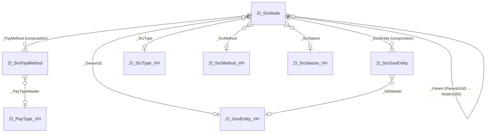
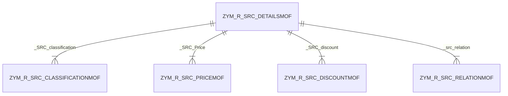

# Architecture

All applications follow the standard RAP layering:

```
Database table  ──►  Interface / "R" view (root BO, behavior definition, handler class)
                         │
                         ▼
                     Projection / "C" view (+ metadata extension for UI)
                         │
                         ▼
                     Service definition ──► Service binding (OData V4/V2) ──► Fiori elements UI
```

Every business object is **managed** (the RAP framework handles CRUD persistence), uses **draft**
(`with draft` + a draft table per entity), runs in **`strict ( 2 )`**, and uses
**optimistic locking** via `etag master LocalLastChangedAt` and `lock master total etag LastChangedAt`.

There are three families of objects, distinguished by prefix:

| Prefix | Family | Generated by |
|--------|--------|--------------|
| `ZI_` / `ZC_` / `ZSRC_` / `ZBP_I_` | SRC Hierarchy app | Hand-written |
| `ZYM_` | SRC Details, Object Types, Relation Types | ADT *Generate ABAP Repository Objects* (OData UI Service) wizard |
| `ZZM_` | Master data (configuration) apps | ADT generator, on top of the hand-written `ZSRC_*_T` tables |

---

## 1. SRC Hierarchy (`ZI_SrcNode`)

The central application. An SRC node is a revenue item in a parent–child tree
(for example *chapter → section → item*). Each node carries classification, channel and financial data,
plus two child lists.

### Composition



| Entity | Alias | Table / draft table | Role |
|--------|-------|---------------------|------|
| `ZI_SrcNode` | `SrcNode` | `ZSRC_NODE` / `ZSRC_D_NODE` | Root; lock, authorization and etag master |
| `ZI_SrcPayMethod` | `PayMethod` | `ZSRC_PAYM` / `ZSRC_D_PAYM` | Accepted payment methods for the item (child) |
| `ZI_SrcGovEntity` | `GovEntity` | `ZSRC_GOV` / `ZSRC_D_GOV` | Agent government entities and their collection percentage (child) |

Projections `ZC_SrcNode`, `ZC_SrcPayMethod`, `ZC_SrcGovEntity` (`provider contract transactional_query`)
add value helps and text elements (`SrcTypeName`, `SrcMethodName`, `SrcNatureName`, `OwnerGEName`).
`ZC_SrcNode` uses `SrcCode` as its semantic key.

### Hierarchy

`ZSRC_HIERARCHY` is a CDS parent–child hierarchy over `ZI_SrcNode`:

- child → parent association `_Parent`
- roots: `ParentUUID is initial`
- siblings ordered by `SrcCode ascending`

The behavior definition declares it as an **instance hierarchy** (`instance hierarchy zsrc_hierarchy`) with a
`copy` action, and `_Parent` exposes `linkManager` / `unlinkManager` link actions so a node can be
attached to or detached from a parent. `ZC_SrcNode` is annotated with
`@OData.hierarchy.recursiveHierarchy`, so Fiori elements renders the list report as a tree table.

### Behavior (`ZI_SrcNode` BDEF, class `ZBP_I_SRCNODE`)

| Element | Definition |
|---------|-----------|
| Standard operations | `create`, `update`, `delete`; children created by association (`_PayMethod`, `_GovEntity`) |
| Draft actions | `Edit`, `Activate optimized`, `Discard`, `Resume`, `Prepare` (Prepare runs `validateNode`, `validateParent`, `validateDates`) |
| Workflow actions | `submitForApproval`, `approve`, `reject`: instance actions with dynamic feature control, each returning `$self` |
| Determinations | `setInitialStatus` (on create), `setInitialLevel` (on create / `ParentUUID` change) |
| Validations | `validateNode` (`SrcCode`, `SrcName`, `SrcType`), `validateParent` (`ParentUUID`), `validateDates` (`StartDate`, `EndDate`) |
| Field control | `NodeUUID` readonly + managed numbering; `ProcessingStatus`, `IsActive`, `NodeLevel` and admin fields readonly; `SrcCode`, `SrcName`, `SrcType` mandatory |
| Authorization | `authorization master ( instance )` on the root; children are `authorization dependent by _Node` |

> **Implementation status:** every method in `lhc_SrcNode` (`zbp_i_srcnode.clas.locals_imp.abap`) is an
> empty stub. The actions, determinations, validations, feature control and instance authorization are
> declared but do nothing yet. See [development.md](development.md#open-items).

### UI (`ZC_SRCNODE` metadata extension)

Object page facets:

| Facet | Arabic label | Contents |
|-------|--------------|----------|
| National structure data | بيانات الهيكل الوطني | Collection of the three field groups below |
| ↳ Basic data | البيانات الاساسية | Code, name, type, description, GFS code, natural account, method, refundable, nature, nature %, owner entity |
| ↳ Service beneficiaries | المستفيدين من الخدمة | `G2C` (individuals), `G2B` (business), `G2G` (government) |
| ↳ Financial data | البيانات المالية | Start/end date, price, discount, currency |
| Payment methods | طرق الدفع | Line items of `_PayMethod` |
| Agent government entities | الجهات الوكيلة | Line items of `_GovEntity` |

The list report shows buttons for *Submit for approval* (ارسال للموافقة), *Approve* (الاعتماد) and *Reject* (الرفض).

---

## 2. SRC Details (`ZYM_R_SRC_DETAILSMOF`)

A generic, time-dependent object model (object type + object ID + validity `Begda`/`Endda`, similar to
SAP HR infotypes) for SRC objects. The root holds short and long texts; four compositions hold dated sub-records.



| Entity | Alias | Table / draft table | Payload |
|--------|-------|---------------------|---------|
| `ZYM_R_SRC_DETAILSMOF` | `Src_details` | `ZYM_SRCDTAILSMOF` / `ZYM_SRCDTLS_DMOF` | `ObjectType`, `ObjectID`, `Begda`, `Endda`, `Stext`, `Ltext` |
| `ZYM_R_SRC_CLASSIFICATIONMOF` | `SRC_classification` | `ZYM_SRCCLSSFCMOF` / `ZYM_SRCCLSS_DMOF` | `Gfs`, `NaturalAccount` |
| `ZYM_R_SRC_PRICEMOF` | `SRC_Price` | `ZYM_SRCPRICEMOF` / `ZYM_SRCPRCE_DMOF` | `Price`, `CurrencyCode` |
| `ZYM_R_SRC_DISCOUNTMOF` | `SRC_discount` | `ZYM_SRCDSCUNTMOF` / `ZYM_SRCDSCN_DMOF` | `Discount`, `Currency` |
| `ZYM_R_SRC_RELATIONMOF` | `src_relation` | `ZYM_SRCRLTIONMOF` / `ZYM_SRCRLTN_DMOF` | From object (`Fotype`, `Fobjid`) → `RelationType`/`RelationID` → to object (`Totype`, `Tobjid`) |

Behavior: managed, draft, `extensible`, `authorization master ( global )`, UUIDs with managed numbering.
Children are etag/lock/authorization dependent on the root. The projection BDEF adds `use side effects`.
The handler classes contain only the generated, empty `get_global_authorizations`.

`ZYM_R_YOBJECT_TYPEMOF` (object types) and `ZYM_R_YRELATIONMOF` (relation types) are single-entity BOs
with the same generated pattern. They act as catalogs for `ObjectType` and `RelationType`.

---

## 3. Master data apps (`ZZM_*`)

Five single-entity, draft-enabled BOs that maintain the code tables used as value helps by the SRC Hierarchy app:

| BO | Table | Key (mandatory on create, readonly on update) | Other fields | Value help view |
|----|-------|---------------------------------|--------------|-----------------|
| `ZZM_R_SRC_TYPE_TMOF` | `ZSRC_TYPE_T` | `TypeCode` | `TypeName` | `ZI_SrcType_VH` |
| `ZZM_R_SRC_METH_T` | `ZSRC_METH_T` | `MethodCode` | `MethodName` | `ZI_SrcMethod_VH` |
| `ZZM_R_SRC_NAT_TMOF` | `ZSRC_NAT_T` | `NatureCode` | `NatureName` | `ZI_SrcNature_VH` |
| `ZZM_R_SRC_PT_TMOF` | `ZSRC_PT_T` | `PtCode` | `PtName`, `IsActive` | `ZI_PayType_VH` |
| `ZZM_R_SRC_GE_TMOF` | `ZSRC_GE_T` | `GeCode` | `GeName`, `Region`, `Iban`, `IsActive` | `ZI_GovEntity_VH` |

Unlike the `ZYM_` BOs, these use the natural code as the key (no UUID).

---

## Authorization

| Object family | CDS access control | Behavior authorization |
|---------------|--------------------|------------------------|
| SRC Hierarchy (`ZI_`/`ZC_`) | `#NOT_REQUIRED` (no DCL) | Instance authorization declared on root; handler is empty |
| `ZYM_` / `ZZM_` | `#MANDATORY`; DCL roles grant `where TRUE` on R views, and C views inherit from the R view | Global authorization; handler is empty |

The `*.sush.xml` objects are the authorization default values (`S_START`) generated for the published
OData V4 services, and the `*_0001_G4BA.sco2.xml` objects are the generated OData V4 service-group
publications that let the services be added to communication scenarios / IAM apps.

## SAP object types

Each `ZYM_`/`ZZM_` root has an SAP Object Type (`*.ront.json`) and an SAP Object Node Type (`*.nont.json`),
referenced through `@ObjectModel.sapObjectNodeType.name` in the R views.
